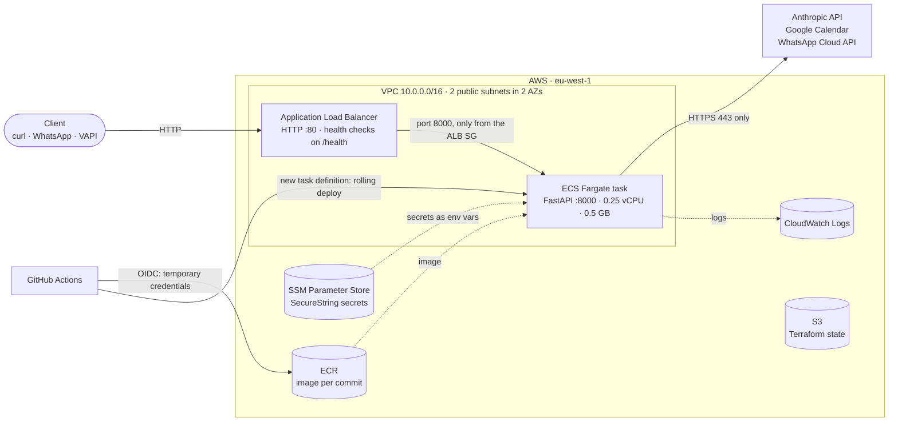
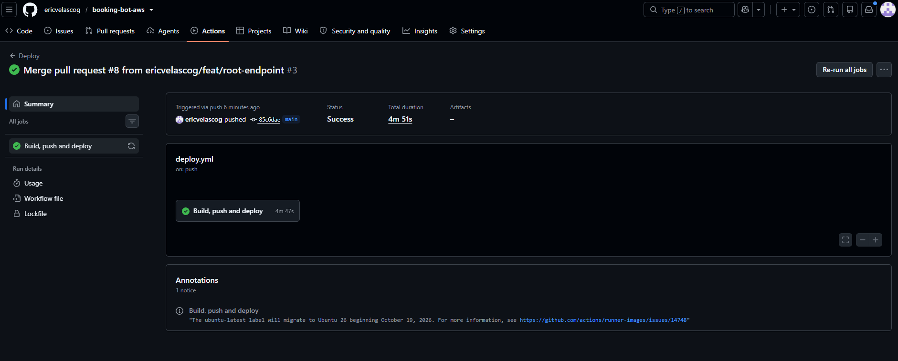
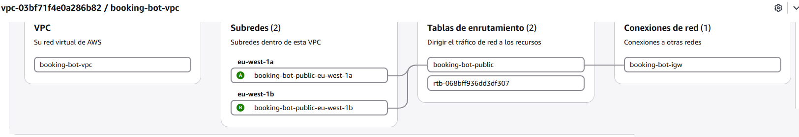
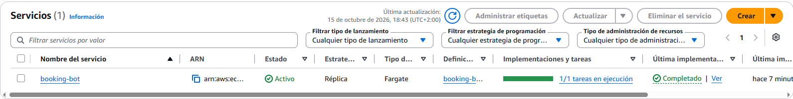

# booking-bot-aws

[](https://github.com/ericvelascog/booking-bot-aws/actions/workflows/ci.yml)
[](https://github.com/ericvelascog/booking-bot-aws/actions/workflows/deploy.yml)

An AI booking assistant for physiotherapy clinics, running on **AWS ECS Fargate**. The infrastructure is defined as code with **Terraform**, and **GitHub Actions** handles CI/CD.

The bot is a FastAPI service that books, lists and cancels appointments over WhatsApp and phone (via VAPI), using the **Claude API** for the conversation and **Google Calendar** as the diary. It started as my bachelor's thesis on Railway. This repository is about taking it to AWS the way a production service would run: containerised, reproducible, deployed automatically and with least-privilege access.

## Architecture



| Layer | What runs there |
|---|---|
| **Network** | VPC with two public subnets in two Availability Zones and an internet gateway. **No NAT Gateway**: tasks get a public IP for outbound calls, and their security group only accepts traffic from the load balancer ([ADR-0001](docs/adr/0001-public-subnets-without-nat.md)). |
| **Entry point** | Application Load Balancer: stable address, `/health` checks every 30 s, zero-downtime deployments. |
| **Compute** | ECS on Fargate: one task, rolling deployments (100 % / 200 %) and the deployment circuit breaker with automatic rollback. |
| **Secrets** | SSM Parameter Store (`SecureString`), injected into the container at start-up. They are uploaded with a script, never through Terraform, so they never end up in the state. |
| **Identity** | Separate ECS roles. The execution role can only pull from this ECR repository, write to this log group and read `/booking-bot/*`. The task role has no permissions, because the app calls no AWS APIs. |
| **Observability** | CloudWatch Logs (7-day retention). `/health` reports the deployed version (the commit SHA). |

## How a change reaches production

```
feature branch → pull request → CI ✅ → merge to main → Deploy workflow → new version live (~5 min)
```

1. **CI on every pull request** ([`ci.yml`](.github/workflows/ci.yml)). Two parallel jobs:
   - the app: `ruff`, `pytest` and `docker build` on Python 3.12;
   - the infrastructure: `terraform fmt -check` and `validate`.

   `main` is protected: pull requests only, both checks required, no exceptions for admins.
2. **CD on every merge to `main`** ([`deploy.yml`](.github/workflows/deploy.yml)):
   1. GitHub authenticates to AWS with **OIDC**. No AWS keys are stored anywhere: AWS only trusts tokens from this repository's `main` branch and returns credentials for a least-privilege role that expire after one hour.
   2. Build the image tagged with the commit and push it to ECR.
   3. If the infrastructure is up, register a new task definition revision and let ECS roll it out.
   4. A smoke test checks that `/health` answers with the new version.

   If the infrastructure is down, the image is pushed and the deployment step is skipped; the next `terraform apply` starts that image.



After a deploy:

```console
$ curl http://<alb-dns-name>/health
{"status":"ok","version":"85c6dae"}
```

## Infrastructure as code

There are two independent Terraform stacks, each with its own state in the same S3 bucket:

| Stack | Contents | Lifecycle |
|---|---|---|
| [`infra/bootstrap`](infra/bootstrap) | State bucket (versioned, encrypted, public access blocked, `prevent_destroy`), ECR repository (immutable tags, scan on push, keeps the last 5 images), GitHub OIDC provider and deploy role | Created once, never destroyed |
| [`infra/app`](infra/app) | VPC, subnets, security groups, ALB, IAM roles for the task, log group, ECS cluster, task definition and service (23 resources) | Created for a demo (`apply`, ~5 min) and destroyed afterwards |

State locking uses S3's native lock file (`use_lockfile`), so no DynamoDB table is needed. Every resource carries `Project`, `ManagedBy` and `Stack` tags for cost allocation.




## Cost

This runs on a personal budget, so cost shaped the design.

| While the app stack is up | Approx. (eu-west-1) |
|---|---|
| Application Load Balancer | $0.025 / h |
| Fargate task (0.25 vCPU, 0.5 GB) | $0.012 / h |
| 3 public IPv4 addresses (ALB × 2, task × 1) | $0.015 / h |
| **Total** | **≈ $0.05 / h** (a 2-hour demo costs about $0.10) |

When the app stack is destroyed, only the bootstrap remains: S3 state, a few images in ECR and free-tier SSM parameters, for a few cents a month. A NAT Gateway (~$35/month) was deliberately left out, and an AWS Budget alerts at 50 % and 100 % of $10/month.

## Security

- **No long-lived credentials.** CI/CD uses OIDC, the console and CLI use MFA with temporary credentials, and no IAM user has access keys.
- **Least privilege everywhere.** Every IAM statement is scoped to this project's resources. The few `"*"` resources are actions that AWS cannot scope, and each one is commented in the code.
- **Network.** Tasks accept traffic only from the ALB security group and can only go out on port 443.
- **Secrets** stay out of the image (`.dockerignore`), out of Git (`.gitignore`) and out of the Terraform state (uploaded with `scripts/put-secrets.ps1`).
- **Container** runs as a non-root user. ECR scans every image on push, and CI builds always pull the latest base image.

These controls are mapped to IT general controls (access, change management, operations), with evidence and known gaps, in [`docs/controls.md`](docs/controls.md).

## Run it yourself

Requirements: an AWS account with CLI credentials, Terraform ≥ 1.11, Docker and the GitHub CLI. Bucket and repository names are specific to this project (`infra/bootstrap`), so adapt them first.

```bash
# 1. Permanent pieces (first apply with local state, then: terraform init -migrate-state)
terraform -chdir=infra/bootstrap init
terraform -chdir=infra/bootstrap apply

# 2. Secrets: copy app/.env.example to app/.env, fill it in, then upload to SSM
powershell -ExecutionPolicy Bypass -File ./scripts/put-secrets.ps1

# 3. An image in ECR: merge to main (the Deploy workflow pushes it) or push one manually

# 4. Start the app (~5 min), test it, and tear it down when done
terraform -chdir=infra/app init
terraform -chdir=infra/app apply
curl "$(terraform -chdir=infra/app output -raw app_url)/health"
terraform -chdir=infra/app destroy
```

### Local development

```bash
docker build -t booking-bot:local app
docker run --rm -p 8000:8000 --env-file app/.env booking-bot:local

# Tests and lint, in the same Python version as the image
docker run --rm -v "$PWD/app:/app" -w /app python:3.12-slim \
  sh -c "pip install -q -r requirements-dev.txt && ruff check . && pytest -v"
```

[`examples/ask-availability.json`](examples/ask-availability.json) is a sample request for the OpenAI-compatible endpoint used by the voice channel:

```bash
curl -X POST http://localhost:8000/llm/chat/completions \
  -H "Content-Type: application/json" --data-binary @examples/ask-availability.json
```

## What I'd change for production

These are known limitations of this version, and most of them are planned next:

- **HTTPS.** Put CloudFront (or a custom domain with ACM) in front of the ALB. HTTPS is also required for the WhatsApp webhook.
- **Stateless sessions.** Conversation history lives in the container's memory, so it is lost on every deploy and can't be shared between tasks. Move it to DynamoDB with a TTL, then run two tasks across both AZs with target-tracking autoscaling.
- **Private subnets** with a NAT Gateway per AZ, keeping only the ALB public.
- **Alerting.** CloudWatch alarms (ALB 5xx, unhealthy hosts) to SNS, structured JSON logs and a runbook.
- **Application security.** An API key on the voice endpoints and verification of WhatsApp's `X-Hub-Signature-256`.
- **Pipeline security.** `terraform plan` posted on pull requests, IaC and image scanning (checkov, Trivy), and CloudTrail.

## Repository layout

```
app/                    FastAPI bot: Dockerfile, tests, lint config
infra/bootstrap/        Terraform: state bucket, ECR, GitHub OIDC + deploy role
infra/app/              Terraform: network, ALB, IAM, ECS
.github/workflows/      ci.yml (pull requests) and deploy.yml (main)
scripts/                put-secrets.ps1: upload app secrets to SSM
docs/adr/               Architecture decision records
docs/controls.md        IT general controls mapping (evidence and gaps)
docs/troubleshooting.md Real problems hit while building this, and how they were diagnosed
```

## About

Built by [Eric Velasco](https://github.com/ericvelascog) while preparing for the AWS Solutions Architect – Associate exam, with Claude Code as a pair programmer. The architecture decisions and trade-offs are documented in [`docs/adr`](docs/adr), and the problems I hit along the way are in [`docs/troubleshooting.md`](docs/troubleshooting.md).
