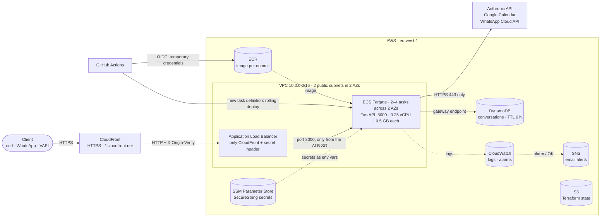
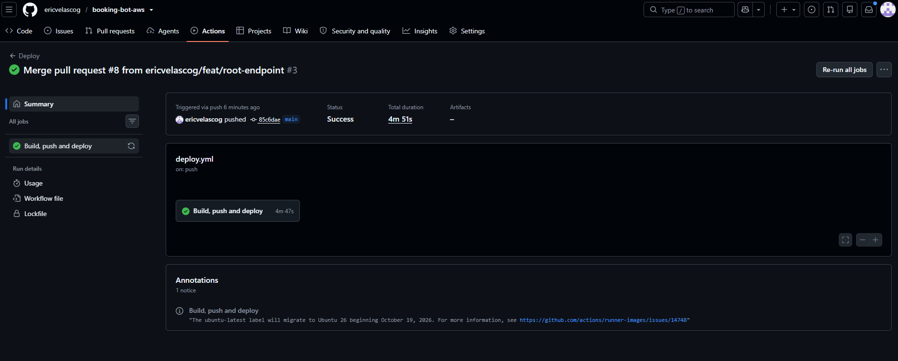
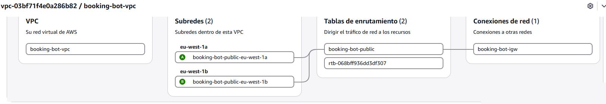
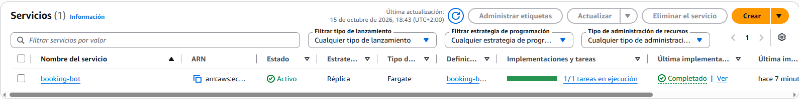

# booking-bot-aws

[](https://github.com/ericvelascog/booking-bot-aws/actions/workflows/ci.yml)
[](https://github.com/ericvelascog/booking-bot-aws/actions/workflows/deploy.yml)

An AI booking assistant for physiotherapy clinics, running on **AWS ECS Fargate**. The infrastructure is defined as code with **Terraform**, and **GitHub Actions** handles CI/CD.

The bot is a FastAPI service that books, lists and cancels appointments over WhatsApp and phone (via VAPI), using the **Claude API** for the conversation and **Google Calendar** as the diary. It started as my bachelor's thesis on Railway. This repository is about taking it to AWS the way a production service would run: containerised, reproducible, deployed automatically and with least-privilege access.

**Live URL:** https://d354dom4m7oqh9.cloudfront.net/health. The backend is started on demand to keep costs down, so a `502` means it is currently off.

## Demo

https://github.com/user-attachments/assets/687a869e-f00c-4a1b-b512-95f72e912d22

A real WhatsApp conversation (in Spanish) booking a physiotherapy session, recorded against this infrastructure:

1. `/health` through CloudFront over HTTPS, returning the commit that is running.
2. The chat on the left; on the right, the container's logs streamed from CloudWatch (`aws logs tail --follow`). Each message arrives as a `POST /webhook` from Meta.
3. The appointment the bot created in Google Calendar.

## Architecture



| Layer | What runs there |
|---|---|
| **Edge** | CloudFront gives HTTPS with the default certificate and a URL that never changes, in a permanent stack that costs nothing while idle ([ADR-0002](docs/adr/0002-cloudfront-edge-stack.md)). |
| **Network** | VPC with two public subnets in two Availability Zones and an internet gateway. **No NAT Gateway**: tasks get a public IP for outbound calls, and their security group only accepts traffic from the load balancer ([ADR-0001](docs/adr/0001-public-subnets-without-nat.md)). |
| **Entry point** | Application Load Balancer, reachable only from CloudFront: its security group allows CloudFront's managed prefix list, and the listener returns `403` without the secret origin header. It runs `/health` checks every 30 s and enables zero-downtime deployments. |
| **Compute** | ECS on Fargate: **two tasks, one per Availability Zone**, with target-tracking autoscaling between 2 and 4 tasks on requests per task ([ADR-0004](docs/adr/0004-autoscale-on-requests-per-task.md)). Deployments are rolling (100 % / 200 %), and the circuit breaker rolls back automatically. |
| **State** | The service is **stateless**. Conversation history is kept in DynamoDB (on-demand, strongly consistent reads, deleted by TTL after 6 hours), so any task can answer any message and a task can die without losing a conversation ([ADR-0003](docs/adr/0003-stateless-sessions-in-dynamodb.md)). |
| **Secrets** | SSM Parameter Store (`SecureString`), injected into the container at start-up. They are uploaded with a script, never through Terraform, so they never end up in the state. |
| **Identity** | Separate ECS roles. The execution role can only pull from this ECR repository, write to this log group and read `/booking-bot/*`. The task role can only get, put and delete items in the sessions table: no `Scan`, no other tables. |
| **Observability** | CloudWatch Logs (7-day retention). `/health` reports the deployed version (the commit SHA). Three alarms email me through SNS when they fire and when they recover: 5xx responses, unhealthy tasks, and failed WhatsApp replies. The last one comes from a log metric filter, because those failures happen after the webhook has already returned `200`. Each alarm links to its section of the [runbook](docs/runbook.md). |

## How a change reaches production

```
feature branch → pull request → CI ✅ → merge to main → Deploy workflow → new version live (~5 min)
```

1. **CI on every pull request** ([`ci.yml`](.github/workflows/ci.yml)). Three parallel jobs:
   - the app: `ruff`, `pytest`, `docker build` on Python 3.12, and a **Trivy** scan of the image for known vulnerabilities;
   - the infrastructure: `terraform fmt -check` and `validate`;
   - security: **checkov** scans the Terraform, the Dockerfile and the workflows for misconfigurations, and the repository for committed secrets ([`docs/security-scanning.md`](docs/security-scanning.md)).

   `main` is protected: pull requests only, all three checks required, no exceptions for admins.
2. **CD on every merge to `main`** ([`deploy.yml`](.github/workflows/deploy.yml)):
   1. GitHub authenticates to AWS with **OIDC**. No AWS keys are stored anywhere: AWS only trusts tokens from this repository's `main` branch and returns credentials for a least-privilege role that expire after one hour.
   2. Build the image tagged with the commit and push it to ECR.
   3. If the infrastructure is up, register a new task definition revision and let ECS roll it out.
   4. A smoke test calls `/health` through the public CloudFront URL and checks that it answers with the new version.

   If the infrastructure is down, the image is pushed and the deployment step is skipped; the next `terraform apply` starts that image.



After a deploy:

```console
$ curl https://d354dom4m7oqh9.cloudfront.net/health
{"status":"ok","version":"85c6dae"}
```

## Resilience, tested

Two tests on the running service (2026-11-10):

1. **A task dies under traffic.** While a loop called `/health` twice a second, I stopped one of the two tasks with `aws ecs stop-task`. **No request failed.** The ALB deregistered the task and drained it before it stopped, and ECS started a replacement one second later.
2. **The task holding a conversation dies.** I told the bot my name on WhatsApp. The logs show that message was handled by the task being stopped. The next message was handled by the other task, and the bot still knew my name, because the conversation lives in DynamoDB, not in the container.

## Infrastructure as code

There are three independent Terraform stacks, split by lifecycle, each with its own state in the same S3 bucket:

| Stack | Contents | Lifecycle |
|---|---|---|
| [`infra/bootstrap`](infra/bootstrap) | State bucket (versioned, encrypted, public access blocked, `prevent_destroy`), ECR repository (immutable tags, scan on push, keeps the last 5 images), GitHub OIDC provider and deploy role, origin secret in SSM, SNS topic for alarms (the email address comes from a git-ignored `terraform.tfvars`), CloudTrail trail and its log bucket | Created once, never destroyed |
| [`infra/edge`](infra/edge) | CloudFront distribution (HTTPS, caching disabled, secret origin header) pointing at the current ALB | Permanent, free while idle; re-applied after `app` to follow the new ALB |
| [`infra/app`](infra/app) | VPC, subnets, DynamoDB gateway endpoint, security groups, ALB with origin check, IAM roles for the task, log group, sessions table, ECS cluster, task definition, service, autoscaling and alarms (34 resources) | Created for a demo (`apply`, ~5 min) and destroyed afterwards |

State locking uses S3's native lock file (`use_lockfile`), so locking needs no DynamoDB table. Every resource carries `Project`, `ManagedBy` and `Stack` tags for cost allocation.




## Cost

This runs on a personal budget, so cost shaped the design.

| While the app stack is up | Approx. (eu-west-1) |
|---|---|
| Application Load Balancer | $0.025 / h |
| 2 Fargate tasks (0.25 vCPU, 0.5 GB each) | $0.024 / h |
| 4 public IPv4 addresses (ALB × 2, tasks × 2) | $0.020 / h |
| DynamoDB (on-demand) and the gateway endpoint | ≈ $0 (a few requests per message; gateway endpoints are free) |
| CloudFront | $0 (free tier: 1 TB and 10 M requests a month) |
| **Total** | **≈ $0.07 / h** (a 2-hour demo costs about $0.14) |

When the app stack is destroyed, only the bootstrap and the edge remain: S3 state, a few images in ECR, free-tier SSM parameters, the CloudTrail logs and an idle CloudFront distribution, for a few cents a month. A NAT Gateway (~$35/month) was deliberately left out, and an AWS Budget alerts at 50 % and 100 % of $10/month.

## Security

- **No long-lived credentials.** CI/CD uses OIDC, the console and CLI use MFA with temporary credentials, and no IAM user has access keys.
- **Least privilege everywhere.** Every IAM statement is scoped to this project's resources. The few `"*"` resources are actions that AWS cannot scope, and each one is commented in the code.
- **Network.** HTTPS for viewers through CloudFront. The ALB only accepts CloudFront's IP ranges and requests that carry the secret origin header. Tasks accept traffic only from the ALB security group and can only go out on port 443. Their traffic to DynamoDB goes through a gateway endpoint and never leaves the AWS network.
- **Personal data** (phone numbers and conversations) is encrypted at rest and deleted automatically after six hours of inactivity.
- **Secrets** stay out of the image (`.dockerignore`), out of Git (`.gitignore`) and out of the Terraform state (uploaded with `scripts/put-secrets.ps1`).
- **Container** runs as a non-root user. Trivy scans the image on every pull request, ECR scans it again on push, and builds always pull the latest base image.
- **Scanned on every pull request.** checkov blocks the merge on any finding that is not fixed or accepted with a written reason. The first scan found 35: 4 were fixed and 31 accepted, each with its reason in the code and in [`docs/security-scanning.md`](docs/security-scanning.md).
- **Pipeline supply chain.** Every GitHub Action is pinned to a commit SHA and kept up to date by Dependabot, and the scanners run in a job with no credentials ([why](docs/security-scanning.md#the-pipeline-is-part-of-the-attack-surface)).
- **Audit trail.** A multi-region CloudTrail trail records every API call in the account for one year, plus every read and write of the Terraform state, in a bucket that only the trail can write to. Log file validation proves the logs have not been altered.

These controls are mapped to IT general controls (access, change management, operations), with evidence and known gaps, in [`docs/controls.md`](docs/controls.md).

## Run it yourself

Requirements: an AWS account with CLI credentials, Terraform ≥ 1.11, Docker and the GitHub CLI. Bucket and repository names are specific to this project (`infra/bootstrap`), so adapt them first.

```bash
# 1. Permanent pieces (first apply with local state, then: terraform init -migrate-state)
terraform -chdir=infra/bootstrap init
terraform -chdir=infra/bootstrap apply

# 2. Secrets: copy app/.env.example to app/.env, fill it in, then upload to SSM
powershell -ExecutionPolicy Bypass -File ./scripts/put-secrets.ps1

# 3. An image in ECR: merge to main (the Deploy workflow pushes it) or push one manually

# 4. Start the app (~5 min), then point the edge at the new ALB
terraform -chdir=infra/app init
terraform -chdir=infra/app apply
terraform -chdir=infra/edge init
terraform -chdir=infra/edge apply
curl "$(terraform -chdir=infra/edge output -raw app_url)/health"

# 5. Tear down only the app stack when done (bootstrap and edge stay)
terraform -chdir=infra/app destroy
```

### Local development

```bash
docker build -t booking-bot:local app
docker run --rm -p 8000:8000 --env-file app/.env booking-bot:local

# Tests and lint, in the same Python version as the image
docker run --rm -v "$PWD/app:/app" -w /app python:3.12-slim \
  sh -c "pip install -q -r requirements-dev.txt && ruff check . && pytest -v"
```

[`examples/ask-availability.json`](examples/ask-availability.json) is a sample request for the OpenAI-compatible endpoint used by the voice channel:

```bash
curl -X POST http://localhost:8000/llm/chat/completions \
  -H "Content-Type: application/json" --data-binary @examples/ask-availability.json
```

## What I'd change for production

These are known limitations of this version, and most of them are planned next:

- **End-to-end encryption.** Viewers get HTTPS, but the CloudFront → ALB hop is HTTP. Use a custom domain with an ACM certificate on the ALB, or CloudFront VPC origins with an internal ALB ([ADR-0002](docs/adr/0002-cloudfront-edge-stack.md)).
- **Concurrent writes to a conversation.** Each message is a read followed by a full write, so two messages from the same person at the same instant could overwrite each other. Use optimistic locking with conditional writes ([ADR-0003](docs/adr/0003-stateless-sessions-in-dynamodb.md)).
- **Scaling target from a load test.** The 120 requests per task per minute is an estimate. Measure where latency degrades and set the target below it ([ADR-0004](docs/adr/0004-autoscale-on-requests-per-task.md)).
- **Private subnets** with a NAT Gateway per AZ, keeping only the ALB public.
- **Observability.** Structured JSON logs, latency alarms (p95 target response time) and a dashboard, plus an on-call channel such as Slack or PagerDuty instead of email.
- **Application security.** An API key on the voice endpoints and verification of WhatsApp's `X-Hub-Signature-256`.
- **Pipeline security.** `terraform plan` posted on pull requests.
- **Alarms on the audit trail.** Send CloudTrail to CloudWatch Logs and alarm on sensitive events (root login, IAM policy changes, the trail being stopped), or enable GuardDuty.
- **Accepted scan findings with a fixed cost.** WAF, customer managed KMS keys and central logs (ALB, CloudFront, VPC flow logs) ([`docs/security-scanning.md`](docs/security-scanning.md#in-production)).

## Repository layout

```
app/                    FastAPI bot: Dockerfile, tests, lint config
infra/bootstrap/        Terraform: state bucket, ECR, GitHub OIDC + deploy role, origin secret, SNS, CloudTrail
infra/edge/             Terraform: CloudFront (HTTPS, stable URL)
infra/app/              Terraform: network, ALB, IAM, ECS, DynamoDB, autoscaling
.github/workflows/      ci.yml (pull requests) and deploy.yml (main)
scripts/                put-secrets.ps1: upload app secrets to SSM
docs/adr/               Architecture decision records
docs/controls.md        IT general controls mapping (evidence and gaps)
docs/runbook.md         What to do when each alarm fires
docs/security-scanning.md  What checkov scans, and why each accepted finding was accepted
docs/troubleshooting.md Real problems hit while building this, and how they were diagnosed
```

## About

Built by [Eric Velasco](https://github.com/ericvelascog), AWS Certified Solutions Architect – Associate, with Claude Code as a pair programmer. The architecture decisions and trade-offs are documented in [`docs/adr`](docs/adr), and the problems I hit along the way are in [`docs/troubleshooting.md`](docs/troubleshooting.md).
