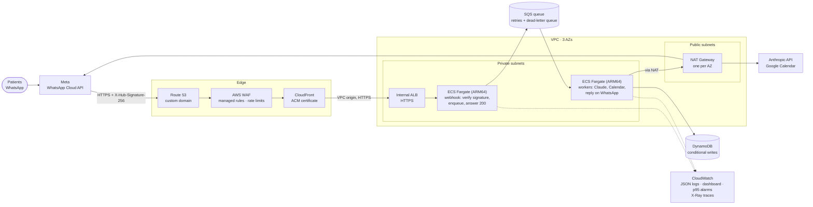

# Well-Architected review

A review of this project against the six pillars of the [AWS Well-Architected Framework](https://docs.aws.amazon.com/wellarchitected/latest/framework/welcome.html): what it does well, where it falls short, and why each gap is accepted at this stage. The last section shows how I would build it for production.

- **Date:** 2026-11-19, at the end of v1.0.
- **Reviewer:** me, so this is a self-assessment. In a team, someone who did not build it should run the review.

## The workload

The review only makes sense against what the system has to do:

- **What it does:** books, lists and cancels physiotherapy appointments over WhatsApp, using the Claude API and Google Calendar.
- **Traffic:** a few conversations a day, in demos. Each message takes seconds, almost all of it waiting for Claude.
- **Data:** personal data (phone numbers, names, conversations). The appointments themselves live in Google Calendar, not in AWS.
- **Availability:** the backend is started for demos and destroyed afterwards. When it is up, it must survive the loss of a task or an Availability Zone.
- **Budget:** a personal one, with an alert at $10 a month.

So "good" here means: secure and resilient while it runs, close to free while it does not, and honest about what production would need.

## Summary

| Pillar | Assessment | Strongest point | Main gap |
|---|---|---|---|
| Operational excellence | Good for one person | Everything is code, every change goes through a reviewed pull request, and deployments roll back on their own | `apply` runs from a laptop, and Terraform and the pipeline both write the task definition |
| Security | Strong | No long-lived credentials, least privilege verified with the policy simulator, and every request that can spend money or change data is authenticated | The CloudFront → ALB hop is plain HTTP, and there is no WAF or rate limiting |
| Reliability | Good while it runs | Stateless tasks in two AZs, failure tested with real traffic, automatic rollback | A message is processed after the webhook has answered, so a failure or a stopped task loses it |
| Performance efficiency | Adequate | Scales on requests per task, the signal that matches an I/O-bound app | The scaling target is an estimate, and there is no latency alarm |
| Cost optimisation | Strong | About $0.07 an hour while up, cents a month while down | Public IPv4 addresses are almost a third of the hourly cost |
| Sustainability | Adequate | Runs only when needed, right-sized, data expires on its own | x86 instead of Graviton (ARM) |

## 1. Operational excellence

**What works**

- **Everything is code.** Three Terraform stacks split by lifecycle: `bootstrap` (permanent), `edge` (permanent, free while idle) and `app` (created and destroyed on demand). The whole `app` stack, 34 resources, comes back in about five minutes.
- **Every change goes through a pull request**, with required checks: lint, tests, image build, `terraform fmt`/`validate` and a security scan. Pull requests that touch `infra/` also get the Terraform plan as a comment ([ADR-0005](adr/0005-terraform-plan-on-pull-requests.md)).
- **Deployments are automatic and reversible.** Every merge to `main` builds an image tagged with the commit, rolls it out with no downtime and smoke-tests `/health`. The ECS circuit breaker rolls back a version that fails its health checks.
- **I always know what is running.** `/health` returns the commit. This settled two investigations ([troubleshooting #007](troubleshooting.md) and a test on 2026-11-18 that ran against the previous version).
- **Learning is written down.** A [runbook](runbook.md) for each alarm, and ten [troubleshooting](troubleshooting.md) entries with symptom, diagnosis, root cause and lesson.

**Gaps, and why they are accepted**

- **`apply` runs from my laptop**, after the merge. With one person, the risk is forgetting it, not misusing it. In production the pipeline would run `apply` with a role that only `main` can assume, after an approval.
- **Two owners for the task definition.** Terraform creates it with the newest image in ECR, and the pipeline then registers new revisions on every merge. After a deployment, the next plan wants to "catch up" with the image and shows a harmless replacement (1 to add, 1 to change, 1 to destroy). That noise hides real changes. The fix is a single owner: the pipeline passes the image tag to Terraform and runs the `apply` itself.
- **Plain-text logs and no dashboard.** Enough to read with `aws logs tail` at this volume. In production: JSON logs, a CloudWatch dashboard and traces.

## 2. Security

**What works**

- **Identity**:
  - no IAM user has access keys, and the people who use the account sign in with MFA;
  - CI/CD uses GitHub OIDC with credentials that expire in an hour. The trust policy matches the repository's immutable IDs and the branch;
  - every role has least privilege, checked with the IAM policy simulator. The task role cannot `Scan` the table, and the pull request role is read-only with explicit denies on secrets and personal data ([controls AC-01 to AC-09](controls.md)).
- **Network:**
  - the load balancer only accepts CloudFront's IP ranges and a secret header;
  - tasks only accept traffic from the load balancer and can only go out on port 443;
  - DynamoDB traffic stays on the AWS network through a gateway endpoint.
- **Application:**
  - the voice endpoints, which spend Claude credit, require an API key;
  - the WhatsApp webhook verifies Meta's HMAC signature on the raw body;
  - both checks run in constant time, before any processing, and the app refuses to start without its secrets ([AC-10, AC-11](controls.md)).
- **Data:**
  - encrypted at rest (DynamoDB, SSM, S3), and conversations are deleted after six hours;
  - logs keep only the last three digits of a phone number, no patient details and no query strings, for seven days ([OP-09](controls.md)).
- **Detection:**
  - a multi-region CloudTrail trail with log file validation;
  - data events on the Terraform state, so every read of it is recorded.
- **Supply chain:**
  - checkov and Trivy run on every pull request, and every finding is fixed or accepted with a written reason ([security-scanning.md](security-scanning.md));
  - GitHub Actions are pinned to commit SHAs and kept up to date by Dependabot.

**Gaps, and why they are accepted**

- **The CloudFront → ALB hop is plain HTTP.** Encrypting it needs a certificate for a domain I would have to buy, or CloudFront VPC origins with a private load balancer ([ADR-0002](adr/0002-cloudfront-edge-stack.md)). The secret header still prevents bypassing CloudFront.
- **Tasks have public IP addresses**, because there is no NAT Gateway ([ADR-0001](adr/0001-public-subnets-without-nat.md)). Nothing can reach them from the internet, but their outbound traffic is not restricted to the three APIs they need.
- **No WAF and no rate limiting.** The authentication checks stop abuse of the endpoints that cost money, and the 4-task maximum caps the bill under a flood. A WAF costs a fixed monthly amount.
- **Nobody is alerted on suspicious activity.** CloudTrail records it, but there are no alarms and no GuardDuty.
- **One administrator, and no second reviewer.** Segregation of duties needs a second person ([controls gaps](controls.md)).

## 3. Reliability

**What works**

- **Stateless service in two Availability Zones.** Conversations live in DynamoDB, so any task can answer any message ([ADR-0003](adr/0003-stateless-sessions-in-dynamodb.md)).
- **Tested, not assumed.** I stopped a task under traffic: no request failed. I also stopped the task that had handled a conversation: the other task carried on with it ([README, "Resilience, tested"](../README.md#resilience-tested)).
- **Self-healing.** ALB health checks, ECS replacing failed tasks, autoscaling between 2 and 4 tasks, and the circuit breaker on deployments.
- **Failures are noticed.** Alarms on 5xx, unhealthy tasks and failed replies, each tested by causing it.
- **Recovery from code.**
  - RTO: about ten minutes to rebuild `app` and re-point `edge`.
  - RPO: conversations are disposable after six hours anyway, and the appointments are in Google Calendar.
  - The Terraform state is versioned.

**Gaps, and why they are accepted**

- **A message can be lost after the webhook answers.** The webhook returns `200` to Meta at once and processes the message in the background, so Meta never retries it. If processing fails, the user gets an apology, and the alarm fires. But if the task is stopped while it processes (a deployment or a scale-in), the message is lost silently. At this volume that is rare and visible in the chat. In production, the webhook would put the message on an SQS queue, and workers would process it with retries and a dead-letter queue.
- **Two messages from the same person at the same instant** can overwrite each other's history: a read followed by a full write. The fix is conditional writes ([ADR-0003](adr/0003-stateless-sessions-in-dynamodb.md)).
- **Single region.** Accepted: a regional outage would stop a demo, not a business. Multi-region would also need the external APIs to be reachable, and they are the real single points of failure: without Claude or Google Calendar the bot cannot book.

## 4. Performance efficiency

**What works**

- **The scaling signal matches the workload.** The bot is I/O-bound: almost all of a request is waiting for Claude, Google or Meta, so CPU stays low under load. It scales on requests per task, measured by the ALB ([ADR-0004](adr/0004-autoscale-on-requests-per-task.md)).
- **Right-sized tasks** of 0.25 vCPU and 0.5 GB, the smallest Fargate size, which is enough for an I/O-bound app.
- **Key-value access.** Each message is one strongly consistent read and one write of a single DynamoDB item.

**Gaps, and why they are accepted**

- **The target of 120 requests per task per minute is an estimate.** It needs a load test to find where latency starts to degrade.
- **There is no latency alarm.** The p95 of `TargetResponseTime` would show a slow dependency before users complain. Most of the response time is the LLM call, so model choice and prompt size matter more than the infrastructure.

## 5. Cost optimisation

**What works**

- **Pay only while it runs.** About $0.07 an hour with the app up, so a two-hour demo costs about $0.14. While it is down, only the state, a few images, the CloudTrail logs and an idle CloudFront distribution remain, for cents a month.
- **The biggest cost was designed out.** No NAT Gateway, which would cost about $35 a month per AZ, more than everything else ([ADR-0001](adr/0001-public-subnets-without-nat.md)).
- **Pay-per-use services** where traffic is low: DynamoDB on demand, CloudFront in its free tier, and a free gateway endpoint.
- **Nothing grows forever.** ECR keeps the last five images, old versions of the state expire, CloudTrail logs are deleted after a year, application logs after seven days, and conversations after six hours.
- **Guard rails.**
  - An AWS Budget alerts at 50 % and 100 % of $10 a month.
  - The task maximum caps the cost of a flood.
  - Every resource is tagged with `Project`, `ManagedBy` and `Stack` for cost allocation.

**Gaps, and why they are accepted**

- **Public IPv4 addresses cost $0.020 an hour**, almost a third of the total: two for the load balancer and one per task. Private subnets would remove the tasks' addresses, but a NAT Gateway costs more than they do.
- **No Fargate Spot.** Spot is much cheaper, and losing one of two tasks is something the service already survives. Not worth it for hours of demo time a month.
- **The budget was created with the CLI**, not in Terraform.

## 6. Sustainability

**What works**

- **It runs only when needed.** The backend is off most of the time, which matters more than any tuning.
- **Shared, managed capacity**: Fargate, DynamoDB and CloudFront, with no idle servers of my own.
- **Right-sized tasks, and data that expires on its own** (conversations, logs, images, old state).

**Gaps, and why they are accepted**

- **x86 instead of Graviton (ARM).** Graviton gives more performance per watt, and Fargate on ARM is about 20 % cheaper. The image is built for x86, matching my PC. In production, CI would build a multi-architecture image and the tasks would run on ARM64.

## How I would build it for production

| Change | Pillar | Why |
|---|---|---|
| **SQS between the webhook and the processing**, with retries and a dead-letter queue | Reliability | No message is lost when processing fails or a task stops, and failed messages can be inspected and replayed. Workers scale on queue depth. |
| **Private subnets, NAT Gateway per AZ, internal ALB as a CloudFront VPC origin** | Security, reliability | Nothing in the VPC is reachable from the internet, traffic is encrypted end to end, and outbound traffic leaves through a known point that can be filtered. |
| **Custom domain with ACM, and WAF with managed rules and rate limits** | Security | HTTPS to the origin, and floods are blocked at the edge before they reach the tasks. |
| **Conditional writes in DynamoDB** | Reliability | Two simultaneous messages cannot overwrite each other. |
| **JSON logs, a dashboard, p95 latency alarms and traces**, and an on-call channel instead of email | Operational excellence, performance | Find which dependency is slow, and get alerted before users notice. |
| **CloudTrail alarms, GuardDuty and Security Hub** | Security | Someone is notified of a root login, a policy change or unusual API activity. |
| **Separate accounts for dev and prod** (AWS Organizations, IAM Identity Center), a second reviewer on every pull request, and `apply` from the pipeline after an approval | Security, operational excellence | Segregation of duties, and a mistake in dev cannot touch prod. |
| **ARM64 (Graviton) tasks**, multi-architecture images | Cost, sustainability | About 20 % cheaper, and more performance per watt. |
| **A load test** to set the scaling targets | Performance | Scaling based on measurements, not estimates. |

**Cost:**
- **This design always on:** about $130 a month before traffic. The two NAT Gateways alone are about $70, then the load balancer and two tasks about $18 each, plus WAF, the public addresses of the load balancer, monitoring and a domain.
- **Today's design, if it ran all month:** about $51.

That difference is the point of the review: each gap above is a decision with a price, not something I missed.
